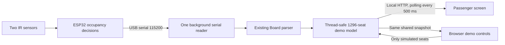

# 17 — Three-car passenger display and hybrid demo

**Implemented:** 2026-10-09. **Physical validation:** pending with teammates; no hardware was available during implementation.

This demo shows 12 logical cars (A–L), each with 108 seats (1296 in total), on the laptop's passenger-facing screen. Two seats are physical (A1 from firmware seat 0/GPIO34, B1 from seat 1/GPIO35); the other 1294 are simulated. The passenger view shows per-car availability and occupancy; the full seat map lives in the controls view, because 1296 seat squares are not readable on a platform display. It is not the passenger-flow/dwell-time simulation, an arriving-train integration, a wireless train link, or a reservation system. No separate monitor is required for development; course approval of the final demonstration format remains separate.

## Run

Requires Python 3.10+ and the dependencies in [requirements.txt](../PC_software/requirements.txt). From the SmartRail root:

```powershell
if (-not (Test-Path .venv)) { py -3 -m venv .venv }
.\.venv\Scripts\python.exe -m pip install -r .\PC_software\requirements.txt
.\.venv\Scripts\python.exe .\PC_software\dashboard.py
```

Use an existing environment if available; always install and launch with the same interpreter. For macOS/Linux, create the environment with `python3 -m venv .venv` and use `.venv/bin/python` for the same commands.

- **Passenger view:** http://127.0.0.1:8765/
- **Control view:** http://127.0.0.1:8765/controls
- Optional startup in hybrid mode: append `--serial-port COM5` (replace with the actual port).
- Alternate web port: append `--http-port 8766` and adjust both URLs.
- Stop with Ctrl+C in the server terminal. All assets are local; internet is not needed after installation.

## Modes and mapping

| Car | Seat 1 in hybrid mode | Seats 2 and 3 |
|---|---|---|
| A | Firmware sensor 0 / GPIO34 | Simulated |
| B | Firmware sensor 1 / GPIO35 | Simulated |
| C | Simulated | Simulated |

**Simulation** is the default. All 1296 seats are software-controlled and no serial device is opened. The example scenario gives each car a fixed number of free seats (A=12, B=3, C=0, D=25, E=48, F=7, G=36, H=18, I=1, J=60, K=29, L=72), scattered inside each car and reproducible run to run. **Next stop** advances the station counter and moves passengers at random within those bounds. The change is not a jump: passengers leave during the first half of a ~2.4 s window and others board during the second, so the seat map and counts move while you watch, and a BOARDING badge is shown. **Auto stops** repeat this every 5–30 seconds for an unattended demo; they are driven by the browser polling, so they only run while a display tab is open. With `--host 0.0.0.0` the passenger view is also served to the local network for a phone or second laptop acting as the platform sign; the controls page, the serial-port list and every state change are refused for requests that did not come from the machine running the dashboard. There is still no password, so viewing is open to anyone on that network. Presets and a mode change cancel a stop in progress and reset the counter to station 1.

In **hybrid** mode, exactly A1/B1 are real, read-only seats. Open the control view, refresh the port list, select or enter a port, and click Connect hardware. Close Arduino Serial Monitor/Plotter and other serial programs first. Connecting may reset the board; keep both physical seats empty until calibration completes and fresh status arrives (roughly 5 s, not guaranteed).

Switching modes applies to every tab. Simulated values are kept in server memory when switching modes, but they never substitute for real values in hybrid mode. Switching to simulation intentionally exposes the last software-controlled values again. Restarting the server restores the example; browser refresh does not. This is a single shared demo session, not per-user state or persistent storage.

## Passenger UI

- Three car cards, free-seat counts, individual seat icons, source labels, and matching platform zones.
- Green = 2–3 free; yellow = 1 free; red = 0 free, **provided all seats in that car are known**.
- Any unknown seat makes the car gray, with a confirmed-free count and explicit unknown count. A gray car can still have confirmed free seats. Unknown seats never increase availability.
- Text accompanies color. Red says “No free seats”, not “car full”, because standing capacity is not sensed.
- The suggestion picks the most confirmed free seats, retains the previous choice on ties, and initially breaks ties A/B/C. Suggestions do not decrement seats or demonstrate optimal passenger distribution.
- Fullscreen button; F11 is a fallback. Responsive layout for laptop and mobile browser sizes.
- Passenger view is read-only; edit controls are on a separate page. This is a UI separation, not an authentication boundary: anyone on this PC with the control URL can operate the demo.

## Controls

- Click simulated seats to toggle empty/occupied.
- Example / Empty simulated seats / Occupy simulated seats presets.
- Real seats are locked both in the UI and at the HTTP API; presets skip them.
- In hybrid mode the example gives 1/3/0 only when both physical seats are empty.
- Connection status, per-sensor age/distance/noise, pending firmware decision, and last board message are visible in diagnostics.
- Firmware WARN messages remain visible until a new boot/calibration or mode configuration. They warn the operator, but are **not** a complete sensor health classifier.

## Data flow and failure behavior



- Model uses the existing [seat_live.py](../PC_software/seat_live.py) `Board` parser; existing console tools and firmware were left unchanged.
- One serial thread owns the port regardless of tab count. Partial lines are assembled; overlong lines are discarded with their tails; opening/reading failures retry roughly every second.
- Configuration generations reject delayed data from a previous mode or port.
- During calibration, real seats are unknown. After the completion marker, a fresh status/event is required before counting them free.
- A real seat becomes unknown after more than 2 s without valid seat data. Other seats can continue reporting independently. Detected transport disconnection clears both real seats immediately.
- The same COM port is retried after unplug/replug. If the OS assigns a new name, change it in controls.
- Browser polling uses a 2.5 s request timeout. A failed poll clears stale counts and diagnostics; polling recovers automatically when the server returns. Physical-action-to-UI latency includes firmware filtering/confirmation and up to a polling interval.
- Missing serial messages are detectable; a disconnected/stuck IR sensor that still results in plausible firmware messages is **not** reliably detected. Do not claim FR-009 is satisfied.
- The dashboard does not log raw sessions automatically. Use screen/video evidence for its run and the existing console logging workflow in a separate run if raw logs are needed. Never open both serial readers simultaneously.

## Local API (IF-04)

All responses are JSON except pages/assets. Mutations require JSON and same-origin browser requests. HTTP errors for invalid input leave state unchanged.

| Method | Path | Input / result |
|---|---|---|
| GET | `/api/state` | mode, connection, cars and seats, free/unknown counts, source labels, suggestion, warnings |
| GET | `/api/ports` | detected device names and descriptions; never auto-opens a port |
| POST | `/api/mode` | `{"mode":"simulation","port":""}` or `{"mode":"hybrid","port":"COM5"}` |
| POST | `/api/seats/A2` | `{"state":"EMPTY"}` or `{"state":"OCCUPIED"}`; rejects real A1/B1 in hybrid |
| POST | `/api/preset` | `{"name":"example"}`, `{"name":"empty"}`, or `{"name":"occupied"}` |

Seat IDs are A1–C3; `source` is `sensor` or `simulated`; `state` is EMPTY/OCCUPIED/UNKNOWN. Counts are integers. `distance_cm`, `noise_mv`, and `age_s` can be null without readings. Sensor IDs are firmware indices; the optional future sensor mapping metadata on A1/B1 is not proof those seats are physical in simulation mode—always check `source`.

The server uses Waitress, binds to 127.0.0.1 only, rejects foreign Host/Origin requests, sends no-store responses and a restrictive content-security policy. No authentication, cloud, TLS or remote deployment support is included. Do not expose it publicly or forward the port.

## Files

| File | Responsibility |
|---|---|
| [dashboard.py](../PC_software/dashboard.py) | Local Flask API and Waitress entry point |
| [dashboard_model.py](../PC_software/dashboard_model.py) | Seat mapping, thread-safe state, source protection, aggregation |
| [dashboard_serial.py](../PC_software/dashboard_serial.py) | One reconnecting serial worker and bounded line framing |
| [dashboard_web/index.html](../PC_software/dashboard_web/index.html) | Passenger and control page structure |
| [dashboard_web/app.js](../PC_software/dashboard_web/app.js) | Synchronized polling, controls and safe offline rendering |
| [dashboard_web/style.css](../PC_software/dashboard_web/style.css) | Local responsive styling; no external fonts/CDN |
| [tests/test_dashboard.py](../PC_software/tests/test_dashboard.py) | Model, API and fake serial tests |
| [tests/browser_dashboard_check.py](../PC_software/tests/browser_dashboard_check.py) | Optional browser integration checks with fake firmware input |

## Validation and remaining work

See [software test evidence](assets/test-results/hybrid-dashboard-software-2026-10-09.md) for actual checks performed. These do not prove sensing accuracy, real upload compatibility, USB-driver behavior or physical latency.

**Give teammates' AI agent [HARDWARE_DASHBOARD_AGENT_HANDOFF.md](HARDWARE_DASHBOARD_AGENT_HANDOFF.md)** for the required physical test plan and evidence template. The next milestone is real two-sensor integration validation, not a claim that the full SmartRail system or dwell-time optimization is complete.