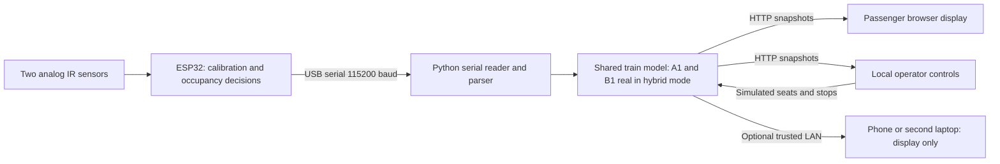

# SmartRail — project overview

**Presentation target:** 18 October 2026. **Source reviewed:** `0883d93`, 13 October 2026. **Evidence level:** implementation inspected; current physical integration not verified in this package.

## One-minute explanation

SmartRail is a prototype for showing train-seat availability to passengers waiting on a platform. A distance sensor checks whether a seat is occupied. An ESP32 makes the occupancy decision, and a laptop dashboard groups those states by train car. Passengers can see which cars have more confirmed free seats and which platform zones correspond to them.

The current demonstration represents 12 cars with 108 seats each. Two seats can use real IR sensors; the other 1,294 are simulated. This lets the team demonstrate a full-train display without physically instrumenting an entire train. The demo also changes simulated seats at virtual station stops.

The broader hypothesis is that better passenger distribution could shorten boarding and train dwell time. **That benefit has not been measured by this demo.** A quantitative passenger-flow model and evaluation remain separate work.

## Problem, users and proposed benefit

- **Problem being explored:** passengers may cluster near some doors while other cars have seats available. Boarding through crowded areas can be inefficient.
- **Intended user:** a passenger on the platform deciding where to wait/board.
- **Prototype operator:** the demonstrator using the control page to change simulated seats and connect sensors.
- **Proposed information:** confirmed seat availability by car and associated platform zone; not standing capacity, a guaranteed seat, an assigned passenger route, or a reservation.
- **Benefit hypothesis:** passengers acting on this information might distribute themselves better. The size of any benefit requires evaluation, not just an animated display.

## Current architecture

One physical ESP32 handles both sensors. The 12 cars are logical groupings in the program; they are not 12 physical networked controllers. Phone viewing over Wi-Fi does not turn the ESP32's USB link into a wireless train-to-platform link.

## Hardware and software

| Part | Role / provenance |
|---|---|
| ESP32 DevKit V1 and two Sharp GP2Y0A21YK0F sensors | Documented physical prototype; confirm actual part labels before presenting |
| GPIO34 / GPIO35 | Firmware sensor indices 0 / 1, mapped to display A1 / B1 |
| Arduino firmware | Median filtering, empty-seat baseline, hysteresis, stable-state confirmation, LED/serial output |
| Python 3.10+, Flask, Waitress, pyserial | Local server, model and USB connection |
| HTML/CSS/JavaScript | Passenger and control views; no Flutter or frontend build step required |
| Laptop; optional phone/second laptop | Prototype platform signage |

Power and wiring must follow [hardware documentation](../Documentation/04_HARDWARE.md) and [pin mapping](../Documentation/05_WIRING_AND_PINOUT.md). Actual capacitor installation, geometry and sensor noise still need recorded measurements.

## What is implemented versus proven

| Capability | Implementation | Evidence still needed for this milestone |
|---|---|---|
| Physical occupancy decisions | Firmware exists for two seats | Current build/upload, actual ten-cycle results, false events and latency |
| Per-car aggregation and seat map | Current code supports 1,296 seats | Fresh software run and screenshots of the exact revision |
| Passenger display | Counts, occupancy, zones, ranked suggestions | Rehearsal on the presentation screen and physical integration |
| Simulated stations | Random bounded alighting/boarding, manual/automatic stops | Demo proof; NOT optimization evidence |
| Hybrid protections | Real seats read-only; missing serial data unknown | Mock coverage exists; actual USB/calibration/recovery evidence pending |
| Network passenger display | Optional local-network viewing, controls restricted to host | Test actual hotspot/firewall/phone if used |
| Wireless ESP32 → station | Not implemented | Architecture and later implementation |
| Quantitative Gaussian vs uniform comparison (`FR-007`) | Not provided by the current dashboard | Mentor-agreed model, experiment and measured results |

## Requirements relevant to the demonstration

The [requirements document](../Documentation/02_REQUIREMENTS_AND_SCOPE.md) is a proposed draft pending mentor confirmation. This demonstration addresses the implementation of seat detection/calibration/filtering (`FR-001`–`FR-003`), aggregation (`FR-004`), signage (`FR-006`) and a visual seat map (`FR-008`). Completion depends on their acceptance criteria, not just the existence of source code.

The current transport is USB. Do not describe this as the completed intended train-to-platform deployment. Missing serial data is detected, but an electrically faulty sensor that still yields plausible messages is not reliably identified; full `FR-009` health monitoring is not established. Settings such as firmware thresholds still require recompilation.

## Limitations to state explicitly

1. Two real inputs, not 1,296 physical sensors.
2. Distance sensing detects a closer target, not reliably “person versus bag”.
3. Correct calibration requires empty seats; near-field sensor readings can be misleading.
4. Suggestions choose up to three cars by current confirmed free seats. They do not model passenger positions, walking, queues, behavior or reservations.
5. “Full” in the UI means no confirmed free **seats**, not no standing room or permission to board.
6. Simulated station numbers and “BOARDING” animation are artificial demo events, not live arrival tracking.
7. Hardware and software limits must be supported by actual measurements; no improvement percentage is claimed.

## Next work, subject to mentor agreement

- Complete and preserve the current hybrid acceptance tests.
- Agree what must be delivered on 18 October and what may be deferred.
- Define the separate passenger-distribution experiment and measurable metric.
- Decide the eventual wireless architecture and real platform deployment.
- Improve runtime configuration and actual sensor-fault detection.

## Sources

Current behavior was derived from [dashboard_model.py](../PC_software/dashboard_model.py), [dashboard.py](../PC_software/dashboard.py), [serial worker](../PC_software/dashboard_serial.py), [firmware](../ESP32/ESP32.ino), [parameters](../ESP32/parameters.h) and the browser implementation. Course scope comes from the supplied schedule image and [requirements/scope](../Documentation/02_REQUIREMENTS_AND_SCOPE.md); the complete official rubric and latest mentor decisions still need confirmation.